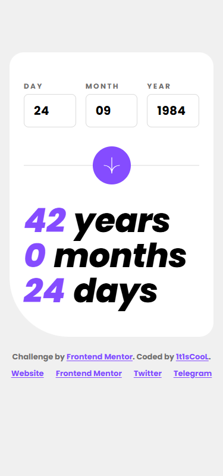

# Frontend Mentor - Age calculator app solution

This is a solution to the [Age calculator app challenge on Frontend Mentor](https://www.frontendmentor.io/challenges/age-calculator-app-dF9DFFpj-Q). Frontend Mentor challenges help you improve your coding skills by building realistic projects.

## Table of contents

- [Overview](#overview)
  - [The challenge](#the-challenge)
  - [Screenshot](#screenshot)
  - [Links](#links)
- [My process](#my-process)
  - [Built with](#built-with)
  - [What I learned](#what-i-learned)
  - [Continued development](#continued-development)
  - [Useful resources](#useful-resources)
- [Development](#development)
- [Author](#author)

## Overview

### The challenge

Users should be able to:

- View an age in years, months, and days after submitting a valid date through the form
- Receive validation errors if:
  - Any field is empty when the form is submitted
  - The day number is not between 1-31
  - The month number is not between 1-12
  - The date is in the future
  - The date is invalid, e.g. 31/04/1991 (there are 30 days in April)
- View the optimal layout depending on their device's screen size (375px / 1440px designs)
- See hover and focus states for all interactive elements
- **Bonus**: see the age numbers animate (count up) to their final value on submit

### Screenshot

| Desktop                              | Mobile                             |
| ------------------------------------ | ---------------------------------- |
|  |  |

### Links

- Solution URL: [Vercel](https://age-calculator-app-main-beta-nine.vercel.app/)
- Live Site URL: [mmalabugin.ru/AgeCalculator](https://mmalabugin.ru/AgeCalculator/)

## My process

### Built with

- Semantic HTML5 with labelled inputs, `aria-invalid`, per-field error descriptions and an `aria-live` results region
- CSS custom properties, Flexbox, desktop-first media queries
- **[Mithril.js 2](https://mithril.js.org/) + Vite 7 + TypeScript** — a hyperscript virtual-DOM framework; the whole UI is built with `m()` calls, a single closure component owns the form state, and `m.redraw()` drives the count-up animation
- Feature-Sliced Design: `app` → `pages` → `widgets` → `features` → `shared`; the date rules (`validateDate` / `calculateAge`) live in `features/age-calc` as pure functions and are unit-tested
- Self-hosted **Poppins** (`font-display: optional` + `<link rel="preload">`) to avoid font-swap layout shift
- `requestAnimationFrame` ease-out count-up with a canceller so a fresh submission aborts the previous animation

### What I learned

- Mithril keeps the view a pure function of state: the error map returned by `validateDate` is the single source of truth for both the red field styling and the messages, so the four error variants (required / out-of-range / not-a-real-date / future) fall out of one data structure.
- The invalid-calendar-date case (e.g. 31/04) is a *whole-form* error in the design — every field turns red but only Day shows "Must be a valid date". Modelling that as `{ day: 'Must be a valid date', month: '', year: '' }` (empty = red-only marker) matched the design without special-casing the view.
- Age maths needs careful borrowing: when the day goes negative, borrow the length of the month *before* today; a `Math.max(0, …)` guard keeps a birth-on-the-31st edge from ever rendering a negative count.
- Keeping the animation outside Mithril's auto-redraw (rAF + manual `m.redraw()`) avoids fighting the framework's render scheduler.

### Continued development

- Paste-a-full-date support and arrow-key increment/decrement on the numeric fields.
- Announce validation failures through a dedicated alert region for screen-reader users who don't move focus.
- A reduced-data count-up that respects `prefers-reduced-motion` by snapping straight to the final values (currently only transitions are gated).

### Useful resources

- [Mithril.js docs](https://mithril.js.org/) — `m()` hyperscript, closure components, and `m.redraw()`.
- [MDN: Date](https://developer.mozilla.org/en-US/docs/Web/JavaScript/Reference/Global_Objects/Date) — `new Date(y, m, 0)` for days-in-month and month borrowing.
- [Feature-Sliced Design](https://feature-sliced.design/) — separating pure date logic from the widget layer.

## Development

```bash
npm install
npm run dev      # http://localhost:5173
npm run test     # vitest (validation + age maths)
npm run build    # tsc + vite build → dist/
```

Deploy convention: `main` targets Vercel (`base` in `vite.config.ts` stays commented). The `deploy` branch enables `base: '/AgeCalculator/'` and is built by Jenkins into a Docker image (nginx) deployed to Kubernetes behind the shared Traefik ingress (`ingresses` repo).

## Author

- Website - [mmalabugin.ru](https://mmalabugin.ru/)
- Frontend Mentor - [@1t1sCooL](https://www.frontendmentor.io/profile/1t1sCooL)
- Twitter - [@vi_el_mar](https://www.twitter.com/vi_el_mar)
- Telegram - [@ItIsCooL](https://t.me/ItIsCooL)
